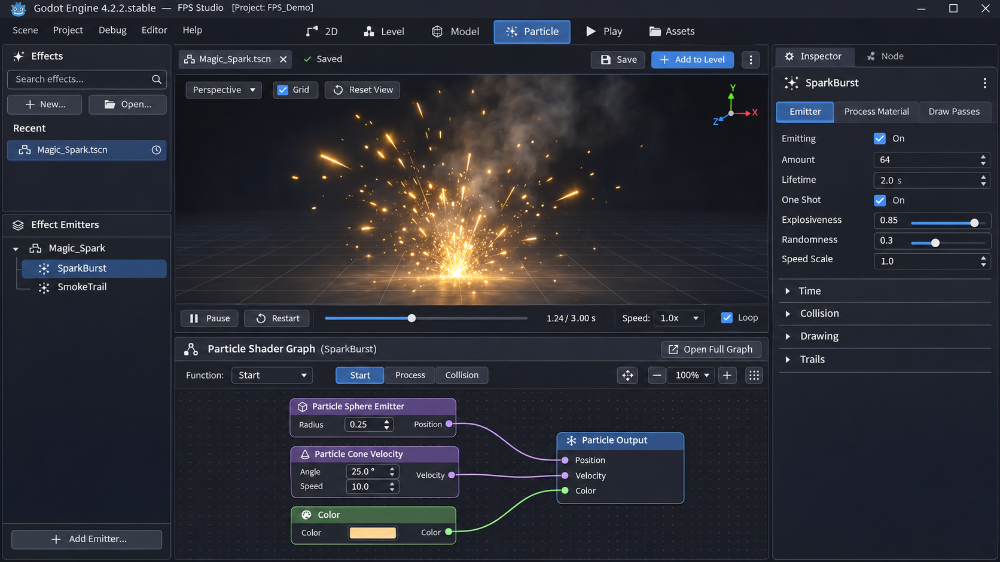

# Pracovní prostředí Particle

Particle workspace je samostatný editor opakovaně použitelných 3D efektů. Efekt upravuje mimo aktivní Level a do herní scény se přidává až příkazem **Add to Level**.

Render je vizuální reference pro další úpravy UI. Levá část představuje knihovnu efektů a strom uzlů efektu, střed celý simulovaný efekt a pravý panel vlastnosti právě vybraného emitoru. Spodní graf v renderu znamená nativní Godot `VisualShader` v režimu Particle; není to graf vztahů mezi emitory. Jeho přímé vložení do workspace zatím není implementované.

Při návrhu práce s efekty zohledňujeme také [tutoriál ohně a jisker od Le Lu](https://www.youtube.com/watch?v=Y1ZBzIiP-v4) a [EffectTextureMaker od Mebiusbox](https://mebiusbox.github.io/contents/EffectTextureMaker/). Oheň, kouř a jiskry se skládají z více emitterů; sprite a další VFX textury jsou samostatné obrazové zdroje. Z Particle workspace je nyní dostupný první nativní generátor: vytváří průhledné textury, ukládá je jako PNG a umí je přiřadit vybranému emitoru. Efektová scéna pak uchovává běžný odkaz na PNG asset.

## Vytvoření a ukládání efektu

- **New** vytvoří prázdný dokument efektu s kořenovým `Node3D` a připraveným GPU nebo CPU emitorem. Nabízí také předvolby Burst, Fountain a Smoke.
- **Open** načte efektovou scénu `.tscn` do Particle workspace. Panel **Effects** zobrazuje nedávno otevřené efekty a umí je filtrovat.
- **Save** nebo **Save As** ukládá celý dokument, včetně více emitorů, jejich potomků a navázaných zdrojů, jako `.tscn`. Běžné materiály a křivky zůstávají nativní Godot resources. Particle `VisualShader` je součástí zdrojů emitoru a lze ho také uložit samostatně jako `.tres`. Obrázková textura se ukládá samostatně (typicky `.png`) a emitter na ni odkazuje přes renderer materiál.
- Starší scéna, jejímž kořenem je přímo `GPUParticles3D` nebo `CPUParticles3D`, se při otevření zachová jako efekt. Nový dokument používá `Node3D` kořen.
- **Add to Level** přidá instanci celého otevřeného efektu do právě upravované Level scény přes editorové Undo/Redo.

Neexistuje žádný pevně vybraný `BubbleParticles`. Při otevření workspace je efektový dokument prázdný; obsah aktuální Level scény se do něj automaticky nepřenáší.

## Emitory a vlastnosti

Levý panel rozděluje nedávné soubory efektů a strom emitorů. **Add** přidá GPU/CPU emitter nebo předvolbu, **Remove** odstraní vybraný uzel. Efekt může obsahovat více particle uzlů; výběr v hierarchii určuje, který emitor se upravuje v pravých kartách **Emitter**, **Process** a **Renderer**.

Vlastnosti upravují Godotovy vestavěné `EditorInspector` panely. `ParticleProcessMaterial` zachovává běžné nastavení procesu. Pokud GPU emitor používá tento materiál, karta Process nabízí také přímé editory křivek Alpha over Life a Scale over Life; nové křivky jsou nativní `CurveTexture` resources. Ostatní vlastnosti zůstávají dostupné v kompletním inspektoru.

Tlačítko **Create Node Graph** změní procesní materiál vybraného GPU emitoru na nativní `VisualShader` v režimu `particles` a otevře graf ve vestavěném Godot Shader Editoru. Nahrazení existujícího materiálu se nejprve potvrdí a změnu lze vrátit přes Undo. Pokud emitor už particle `VisualShader` používá, tlačítko otevře tento graf. CPU particles nemají particle shader graph.

`VisualShader` je graf výpočtu shaderu pro vybraný GPU emitor. Neřídí hierarchii, počet emitorů ani celý efekt. Vztahy a společné uložení emitorů řeší strom scény `.tscn`; shaderový graf je zdroj použitý jedním emitorem. Workspace proto tyto vrstvy rozlišuje.

## 3D náhled a simulace

Náhled simuluje izolovanou kopii celé hierarchie efektu ve vlastním `SubViewport`, s vlastním prostředím, světly, kamerou a referenční mřížkou. Chybějící draw mesh nebo GPU process material doplní pouze náhledová kopie; editovaný efekt se tím nemění.

- Levé nebo pravé tažení myší otáčí kameru, prostřední tažení náhled posouvá a kolečko přibližuje.
- **Reset View** znovu orámuje rozsah emitovaných particle uzlů. **Grid** zapíná referenční mřížku.
- **Play/Pause**, **Restart**, časová osa, **Speed** a **Loop** ovládají lokální simulaci. Smyčka je výchozím stavem zapnutá.
- Časová osa má délku nejdelší životnosti emitoru. Posun na jiné místo resetuje particle uzly a přehrává simulaci dopředu do zvoleného času; nejde o přímý skok na přesně rekonstruovaný stav.

## Současné hranice a další práce

- Náhled a nastavení jsou integrovány, ale VisualShader graf se zatím otevírá ve vlastním Godot Shader Editoru. Dolní panel workspace zatím zobrazuje stav materiálu a akci Create/Edit Node Graph; na renderu je zobrazený budoucí cíl přímé integrace.
- Předvolby emitorů jsou dostupné při tvorbě, ale úprava názvu vybraného emitoru přímo ze stromu ještě chybí.
- Základní křivky Alpha a Scale lze vytvářet a upravovat. Další křivky, křivkové presety a samostatný pohodlný editor každé podporované varianty jsou další iterace.
- **Texture Generator** otevírá nativní nástroj s průhledným 2D náhledem. Nabízí předvolby Fire, Smoke, Explosion a Spark streak, změnu seedu, rozlišení a dvou barev. **Export PNG** uloží výsledek do projektu; po exportu ho lze přes **Apply to Emitter** přiřadit materiálu zvoleného GPU/CPU emitoru. Efektová `.tscn` tak pracuje s běžným PNG assetem.
- První generátor je procedurální implementace v Godot editoru, inspirovaná veřejným popisem pracovního postupu EffectTextureMaker. Minifikované zdrojové kódy tohoto webu nejsou převzaté, protože licence konkrétních souborů není jednoznačně doložená. Samotná CC0 licence generovaných textur nepokrývá automaticky jeho implementační kód.
- Zatím chybí animované sprite sheety, ukládání nastavení generátoru, normal mapy, seamless tiling a další generátory/procesní režimy. Jejich další kroky popisuje [plán Particle workspace](particle_workspace_plan.md).
- Náhled kopíruje podstrom uloženého efektu. Kolizní nebo attractor uzly, které jsou mimo tento podstrom ve scéně Level, se do simulace nepřidají.

## Implementace

Workspace implementuje `FPSStudioParticleEditorPlugin` v `engine/editor/fps_studio/particle_editor_plugin.cpp`. Používá nativní uzly a resources Godotu, `EditorInspector`, vlastní náhledovou kopii a vestavěný VisualShader editor. Součástí zdokumentované designové reference je [particle_workspace_concept.png](images/particle_workspace_concept.png).
