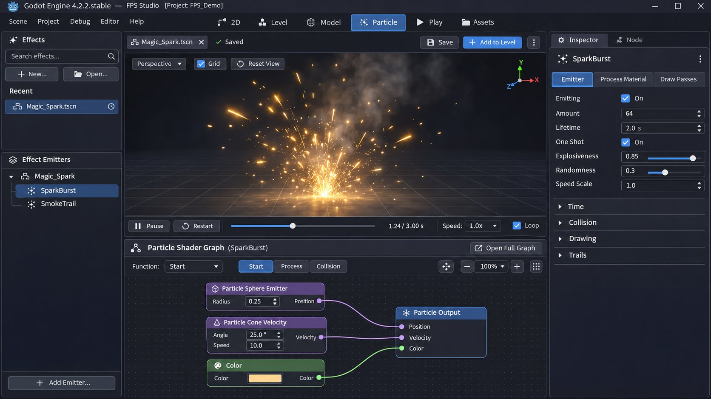

# Pracovní prostředí Particle

Particle workspace je samostatný editor opakovaně použitelných 3D efektů. Efekt upravuje mimo aktivní Level a do herní scény se přidává až příkazem **Add to Level**.

Render je vizuální reference pro rozložení UI. Levá část představuje knihovnu efektů a strom uzlů efektu, střed celý simulovaný efekt a pravý panel vlastnosti právě vybraného emitoru. Spodní graf je nativní Godot `VisualShader` v režimu Particle; není to graf vztahů mezi emitory. Vybraný GPU emitor lze upravovat přímo ve vloženém shaderovém editoru.

Při návrhu práce s efekty zohledňujeme také [tutoriál ohně a jisker od Le Lu](https://www.youtube.com/watch?v=Y1ZBzIiP-v4) a [EffectTextureMaker od Mebiusbox](https://mebiusbox.github.io/contents/EffectTextureMaker/). Oheň, kouř a jiskry se skládají z více emitterů; sprite a další VFX textury jsou samostatné obrazové zdroje. Z Particle workspace je nyní dostupný první nativní generátor: vytváří průhledné textury, ukládá je jako PNG a umí je přiřadit vybranému emitoru. Efektová scéna pak uchovává běžný odkaz na PNG asset.

## Vytvoření a ukládání efektu

- **New** vytvoří prázdný dokument efektu s kořenovým `Node3D` a připraveným GPU nebo CPU emitorem. Nabízí také předvolby Burst, Fountain a Smoke.
- **Open** načte efektovou scénu `.tscn` do Particle workspace. Panel **Effects** zobrazuje nedávno otevřené efekty a umí je filtrovat.
- **Save** nebo **Save As** ukládá celý dokument, včetně více emitorů, jejich potomků a navázaných zdrojů, jako `.tscn`. Běžné materiály a křivky zůstávají nativní Godot resources. Particle `VisualShader` je součástí zdrojů emitoru a lze ho také uložit samostatně jako `.tres`. Obrázková textura se ukládá samostatně (typicky `.png`) a emitter na ni odkazuje přes renderer materiál.
- Název rootu efektu změníš dvojklikem na jeho titulek v horním záhlaví. Dialog upraví název uzlu podle pravidel Godotu a změnu můžeš vrátit přes Undo/Redo.
- Starší scéna, jejímž kořenem je přímo `GPUParticles3D` nebo `CPUParticles3D`, se při otevření zachová jako efekt. Nový dokument používá `Node3D` kořen.
- **Add to Level** přidá instanci celého otevřeného efektu do právě upravované Level scény přes editorové Undo/Redo.

Neexistuje žádný pevně vybraný `BubbleParticles`. Při otevření workspace je efektový dokument prázdný; obsah aktuální Level scény se do něj automaticky nepřenáší.

## Emitory a vlastnosti

Levý panel rozděluje nedávné soubory efektů a strom emitorů. **Add** přidá GPU/CPU emitter nebo předvolbu, **Remove** odstraní vybraný uzel. Dvojklikem na název v hierarchii emitter přejmenuješ; změna podporuje Undo/Redo a při duplicitním názvu dostane uzel volný název. Efekt může obsahovat více particle uzlů; výběr v hierarchii určuje, který emitor se upravuje v pravých kartách **Emitter**, **Process** a **Renderer**.

Vlastnosti upravují Godotovy vestavěné `EditorInspector` panely. Pokud GPU emitor používá `ParticleProcessMaterial`, karta Process zobrazuje křivky Alpha over Life a Scale over Life ještě před úplným inspektorem, aby byly rychle dostupné. **Presets** nabízí pro Alpha Fade Out (Linear/Smooth), Fade In, Fade In and Out a Hold then Fade; pro Scale Grow, Shrink, Grow and Shrink, Hold then Grow a Steady. Preset vytvoří křivku, pokud zatím neexistuje. Křivky jsou nativní `CurveTexture` resources a změny presetů i bodů lze vrátit přes Undo/Redo. Ostatní vlastnosti zůstávají dostupné v kompletním inspektoru.

Tlačítko **Create Node Graph** změní procesní materiál vybraného GPU emitoru na nativní `VisualShader` v režimu `particles` a zobrazí jeho graf ve spodním panelu **Particle Logic**. Nový graf obsahuje připojený SphereEmitter pro tvar spawnu a ConeVelocity pro počáteční rychlost; při otevření se přizpůsobí dostupné ploše. Náhled shaderu je ve vloženém panelu skrytý, aby graf dostal více místa. Panel Particle Logic se bez vybraného emitoru skryje. Nahrazení existujícího materiálu se nejprve potvrdí a změnu lze vrátit přes Undo. Pokud emitor už particle `VisualShader` používá, spodní panel zobrazuje jeho graf a tlačítko **Open in Shader Editor** jej navíc otevře ve velkém Shader Editoru. Výběr jiného GPU emitoru přepne vložený graf na jeho materiál. CPU particles nemají particle shader graph.

`VisualShader` je graf výpočtu shaderu pro vybraný GPU emitor. Neřídí hierarchii, počet emitorů ani celý efekt. Vztahy a společné uložení emitorů řeší strom scény `.tscn`; shaderový graf je zdroj použitý jedním emitorem. Workspace proto tyto vrstvy rozlišuje.

## 3D náhled a simulace

Náhled simuluje izolovanou kopii celé hierarchie efektu ve vlastním `SubViewport`, s vlastním prostředím, světly, kamerou a referenční mřížkou. Chybějící draw mesh nebo GPU process material doplní pouze náhledová kopie; editovaný efekt se tím nemění.

- Levé nebo pravé tažení myší otáčí kameru, prostřední tažení náhled posouvá a kolečko přibližuje.
- **Reset View** znovu orámuje rozsah emitovaných particle uzlů. **Grid** zapíná referenční mřížku.
- **Play/Pause**, **Restart**, časová osa, **Speed** a **Loop** ovládají lokální simulaci. Smyčka je výchozím stavem zapnutá.
- Časová osa má délku nejdelší životnosti emitoru. Posun na jiné místo resetuje particle uzly a přehrává simulaci dopředu do zvoleného času; nejde o přímý skok na přesně rekonstruovaný stav.

## Současné hranice a další práce

- Šířky hlavních panelů se ukládají do rozvržení editoru a při dalším spuštění obnoví. Při úzkém okně se zkracuje document toolbar a časový popisek přehrávání je v pevně širokém ořezávacím kontejneru, aby jeho měnící se čísla nerozhazovala minimální šířku panelů. Uživatel potvrdil, že cukání pravé strany při pohybu časové osy už nepozoruje.
- Dvojklik na název emitoru ve stromu zahájí přejmenování; změna se objeví také v popisku náhledu a lze ji vrátit přes Undo/Redo.
- Křivky Alpha a Scale mají účelové presety i nativní CurveEditor. Další parametry procesu zatím nemají vlastní zjednodušené křivkové karty.
- **Texture Generator (VFX Texture Generator)** otevírá nativní nástroj s průhledným 2D náhledem pro procedurální generování VFX textur a animovaných sprite sheetů.
  - **3D volumetrický raymarching pro exploze**: Pro předlohy `Explosion (Fireball)` a `Explosion 2 (Shockwave ring)` využívá skutečný 3D objemový raymarching (inspirovaný Dukeovým algoritmem z EffectTextureMakeru). Na rozdíl od starších 2.5D plošných řezů ($z = \sqrt{1 - r^2}$), které tvořily ploché komiksové vrstevnice a stuhovité obrysy, volumetrický výpočet vrhá paprsek skrze 3D kouli v 64 krocích, akumuluje hustotu Otaviogoodova rotačního spirálového šumu a 3D FBM, simuluje optickou absorpci (Beer-Lambert zákon), vnitřní rozptyl bodového záření (Bloom) v jádře a filmové mapování tónů (Filmic curve dle Johna Hablea). Výsledkem jsou hluboké, žhavé filamenty, měkké kouřové zákaly a fotorealistický přechod z bíložhavého jádra do temného kouře.
  - **Paralelizace přes WorkerThreadPool**: Výpočet scanlines volumetrického raymarchingu je paralelizován přes nativní vlákna enginu, takže plně vytěžuje vícejádrové CPU (Apple Silicon) a náhled (256×256) generuje za cca 18 ms.
  - **Předvolby a parametry**: Nabízí 15 procedurálních typů ve skupinách (Oheň, Kouř, Ohnivá koule, Tlaková vlna, Jiskry, Blesky, Oblouky, Mraky, Prstence, Magické kruhy, Kaustiky, Bubliny, Plasma aj.). Posuvníky řídí Speed, Density, Emission, Turbulence / Detail, Contrast / Sharpness a Rotation (úhel).
  - **Herní styly (Game style presets)**: Předvolby `Realistic (Cinematic)`, `Medium (Balanced)`, `Low (Performance / Retro)`, `Cartoon / Toon` a `Custom` umožňují rychlé přepínání mezi filmovým realismem, vyváženým nastavením, retro stylizací a komiksovou grafikou.
  - **Pokročilé zpracování a výstupy**:
    - *Polární konverze (Polar coordinates)*: transformuje kartézské procedurální šumy do kruhových a vířivých polárních souřadnic.
    - *Toon shading*: nastavitelná 3-tónová kvantizace prahů jasu pro stylizovanou anime/kreslenou grafiku.
    - *Seamless tiling*: periodické vzorkování okrajů pro bezešvé dlaždicování s nastavitelnou radiální maskou.
    - *Alfa zpracování*: prahování (threshold), měkké 3×3 rozostření a náhled černobílé alfa masky.
    - *Normal map export*: volitelný PNG export tangent-space normálové mapy odvozené ze Sobelova gradientu výšky alfy s nastavitelným výškovým měřítkem (cHeightScale).
    - *Barevné tónování (Color Balance)*: úprava odstínů pro stíny, střední tóny a světla.
    - *Recepty (.cfg v2)*: ukládání a načítání kompletního nastavení generátoru do textového receptu vedle projektu.
    - *Automatické nastavení emitoru*: při **Apply to Emitter** nastaví synchronně naimportovanou texturu do `StandardMaterial3D`, automaticky aktivuje `BILLBOARD_PARTICLES` a u sprite sheetů nakonfiguruje horizontální i vertikální dělení atlasu (`particles_anim_h_frames` / `v_frames`).
- Náhled kopíruje podstrom uloženého efektu. Kolizní nebo attractor uzly, které jsou mimo tento podstrom ve scéně Level, se do simulace nepřidají.

## Implementace

Workspace implementuje `FPSStudioParticleEditorPlugin` v `engine/editor/fps_studio/particle_editor_plugin.cpp`. Používá nativní uzly a resources Godotu, `EditorInspector`, vlastní náhledovou kopii a vestavěný VisualShader editor. Součástí zdokumentované designové reference je [particle_workspace_concept.png](images/particle_workspace_concept.png).
