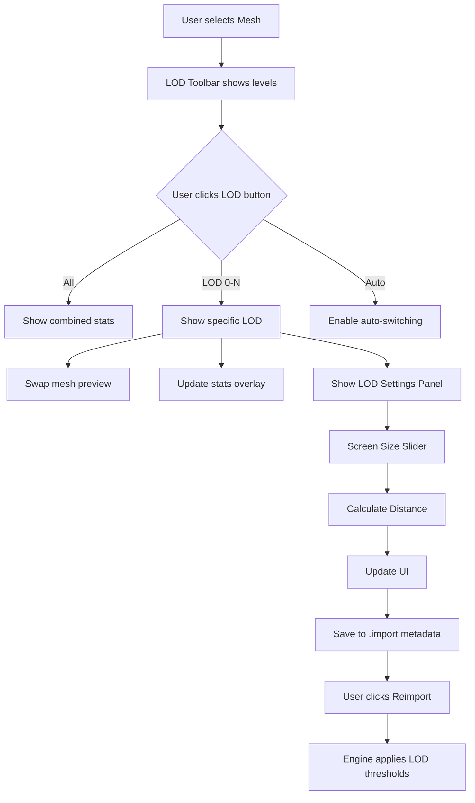

# LOD UI Redesign - UE5 Style
**Datum:** 29. 10. 2026  
**Status:** Návrh - čeká na schválení

## 1. Aktuální problémy

### 1.1 Současný stav
- **Overlay zobrazuje všechny LOD najednou**: `"LOD Levels: 0: 41.2k / 1: 20.6k / 2: 10.3k / 3: 5142 / 4: 2569..."`
- **Není možnost nastavit vzdálenosti přepínání**: Chybí UI pro Screen Size thresholds a transition distances
- **Manuální LOD picker je nepraktický**: OptionButton s "LOD Auto" / "LOD 0" / "LOD 1" je skrytý
- **LOD bias slider není intuitivní**: Hodnota 0.25-4.0 není uživatelsky přívětivá
- **Chybí per-level detaily**: Nelze vidět kompletní informace o aktivním LOD

### 1.2 Požadovaný workflow (UE5 inspirovaný)
```
1. Vybrat mesh v Mesh tree
2. Otevřít LOD Settings panel
3. Přepnout na LOD level (LOD 0, LOD 1, LOD 2...)
4. Vidět POUZE aktivní LOD s kompletními statistikami
5. Nastavit Screen Size threshold pro tento level
6. Preview změny v realtime viewportu
```

---

## 2. Nová architektura UI

### 2.1 LOD Level Toolbar (Horizontal Tab-like Picker)
Nahrazuje současný `OptionButton` ("LOD Auto") kompaktnějším horizontálním pickrem:

```
┌──────────────────────────────────────────────────┐
│  LOD Levels                                      │
│  ┌──────┬──────┬──────┬──────┬──────┐           │
│  │ All  │ LOD0 │ LOD1 │ LOD2 │ LOD3 │  [Auto]  │
│  └──────┴──────┴──────┴──────┴──────┘           │
└──────────────────────────────────────────────────┘
       ↑ Aktivní
```

**Komponenty:**
- `HBoxContainer` s horizontálními tlačítky
- **"All"** = zobrazí celkovou statistiku (současný stav)
- **"LOD0", "LOD1", "LOD2"...** = zobrazí pouze daný level
- **"Auto" toggle** = zapne automatické LOD switching s bias sliderem

### 2.2 Active LOD Info Panel (Inspector Integration)
Nový dedikovaný panel v pravé části inspektoru:

```
╔═══════════════════════════════════════════════════╗
║ LOD 0                                    [Active] ║
║ ━━━━━━━━━━━━━━━━━━━━━━━━━━━━━━━━━━━━━━━━━━━━━━━║
║                                                   ║
║ Geometry                                          ║
║   Triangles:     41,234                          ║
║   Vertices:      24,567                          ║
║   Reduction:     0% (Base)                       ║
║                                                   ║
║ LOD Transition                                    ║
║   Screen Size:   [1.0     ] (100%)              ║
║   Distance:      [0.0  m  ]                     ║
║   ┌─────────────────────────────────────────┐  ║
║   │ ⚠ This is the highest quality LOD      │  ║
║   └─────────────────────────────────────────┘  ║
║                                                   ║
║ [Generate Lower LODs...]                         ║
╚═══════════════════════════════════════════════════╝

╔═══════════════════════════════════════════════════╗
║ LOD 1                                    [Select] ║
║ ━━━━━━━━━━━━━━━━━━━━━━━━━━━━━━━━━━━━━━━━━━━━━━━║
║                                                   ║
║ Geometry                                          ║
║   Triangles:     20,617 (↓ 50.0%)               ║
║   Vertices:      12,284 (↓ 50.0%)               ║
║   Reduction:     50%                             ║
║                                                   ║
║ LOD Transition                                    ║
║   Screen Size:   [0.5     ] (50%)               ║
║   Distance:      [12.5 m  ]                     ║
║   ┌─────────────────────────────────────────┐  ║
║   │ Switches when model covers < 50% of     │  ║
║   │ screen height (~12.5m from camera)      │  ║
║   └─────────────────────────────────────────┘  ║
║                                                   ║
║ [✓] Enable This LOD Level                        ║
║ [Remove LOD Level]                               ║
╚═══════════════════════════════════════════════════╝
```

**Features:**
- **Geometry stats** - pouze pro aktivní LOD
- **Screen Size slider** (0.0 - 1.0) - Threshold kdy se LOD aktivuje
- **Distance estimation** - Automatický výpočet vzdálenosti z Screen Size
- **Reduction percentage** - % redukce oproti LOD 0
- **Visual hints** - Tooltips vysvětlující co hodnoty znamenají
- **Enable/Disable toggle** - Možnost vypnout konkrétní LOD level

### 2.3 Mesh Stats Overlay (Bottom-right)
Zjednodušení overlay v 3D viewportu:

**Současný stav (nepřehledný):**
```
LOD 0 Triangles: 41.2k
LOD Vertices: 24.6k
LOD Levels: 0: 41.2k / 1: 20.6k / 2: 10.3k / 3: 5142 / 4: 2569 / 5: 1229 / 6: 317 / 7: 70
Mode: Auto (bias 1.00)
```

**Nový stav (přehledný):**
```
┌─────────────────────────────┐
│ Active LOD: 0 (Base)        │
│ Triangles:  41,234          │
│ Vertices:   24,567          │
│ Screen Size: 100%           │
│                             │
│ [LOD0] LOD1  LOD2  LOD3 ... │
└─────────────────────────────┘
```

**Když je vybrán konkrétní LOD:**
```
┌─────────────────────────────┐
│ Viewing: LOD 1              │
│ Triangles:  20,617 (↓50%)   │
│ Vertices:   12,284 (↓50%)   │
│ Screen Size: 50%            │
│                             │
│ LOD0 [LOD1] LOD2  LOD3 ...  │
└─────────────────────────────┘
```

---

## 3. Implementation Plan

### 3.1 C++ Header Changes (`scene_import_settings.h`)

```cpp
// Nové LOD UI komponenty
class LODLevelButton : public Button {
    GDCLASS(LODLevelButton, Button)
    int lod_level = 0;
    bool is_selected = false;
};

// V SceneImportSettingsScreen:
class SceneImportSettingsScreen : public Control {
    // ...

    // LOD UI Components
    HBoxContainer *lod_toolbar = nullptr;
    Vector<LODLevelButton*> lod_level_buttons;
    Button *lod_all_button = nullptr;
    CheckButton *lod_auto_toggle = nullptr;
    
    // LOD Settings Panel (v inspektoru)
    VBoxContainer *lod_settings_panel = nullptr;
    
    // Per-LOD level settings
    struct LODLevelSettings {
        int level = 0;
        float screen_size = 1.0f;        // 0.0 - 1.0 (threshold)
        float distance = 0.0f;           // Estimated distance in meters
        bool enabled = true;
        uint64_t triangle_count = 0;
        uint64_t vertex_count = 0;
        float reduction_percent = 0.0f;  // % reduction vs LOD 0
    };
    Vector<LODLevelSettings> lod_level_settings;
    
    // Current active LOD preview
    enum LODViewMode {
        LOD_VIEW_ALL,      // Show combined stats
        LOD_VIEW_LEVEL,    // Show specific level
        LOD_VIEW_AUTO      // Auto-switching with bias
    };
    LODViewMode lod_view_mode = LOD_VIEW_ALL;
    int active_lod_level = 0;
    
    // LOD Metadata persistence
    Dictionary lod_metadata;  // Stores per-mesh LOD settings
    
    // Methods
    void _build_lod_toolbar();
    void _build_lod_settings_panel();
    void _update_lod_buttons();
    void _update_lod_settings_panel();
    void _on_lod_level_selected(int p_level);
    void _on_lod_all_pressed();
    void _on_lod_auto_toggled(bool p_enabled);
    void _on_lod_screen_size_changed(int p_level, float p_screen_size);
    float _calculate_distance_from_screen_size(float p_screen_size);
    void _gather_lod_level_settings();
    void _save_lod_metadata();
    void _load_lod_metadata();
};
```

### 3.2 UI Layout Changes

#### 3.2.1 LOD Toolbar Position
Umístění: **Nad 3D viewport, pod Actions menu**

```cpp
// V SceneImportSettingsScreen::SceneImportSettingsScreen()

// Po vytvoření menu_hb a file_label:

// LOD Toolbar
_build_lod_toolbar();

// Zbytek viewport setup...
tree_split = memnew(HSplitContainer);
// ...
```

#### 3.2.2 LOD Settings Panel v Inspector
Nahrazuje současné mesh/material property sectiony:

```cpp
void SceneImportSettingsScreen::_build_lod_settings_panel() {
    lod_settings_panel = memnew(VBoxContainer);
    lod_settings_panel->set_name("LOD Settings");
    
    // LOD Level Cards
    for (int i = 0; i < lod_level_settings.size(); i++) {
        PanelContainer *level_card = memnew(PanelContainer);
        VBoxContainer *card_vb = memnew(VBoxContainer);
        level_card->add_child(card_vb);
        
        // Header
        HBoxContainer *header = memnew(HBoxContainer);
        Label *level_label = memnew(Label);
        level_label->set_text(vformat("LOD %d", i));
        header->add_child(level_label);
        
        Button *select_btn = memnew(Button);
        select_btn->set_text(i == active_lod_level ? "Active" : "Select");
        select_btn->connect("pressed", callable_mp(this, 
            &SceneImportSettingsScreen::_on_lod_level_selected).bind(i));
        header->add_child(select_btn);
        card_vb->add_child(header);
        
        // Geometry Stats
        Label *geo_label = memnew(Label);
        geo_label->set_text(vformat(
            "Triangles: %s\nVertices: %s\nReduction: %.1f%%",
            _format_stats_count(lod_level_settings[i].triangle_count),
            _format_stats_count(lod_level_settings[i].vertex_count),
            lod_level_settings[i].reduction_percent
        ));
        card_vb->add_child(geo_label);
        
        // Screen Size Control
        HBoxContainer *screen_hb = memnew(HBoxContainer);
        Label *screen_label = memnew(Label);
        screen_label->set_text("Screen Size:");
        screen_hb->add_child(screen_label);
        
        HSlider *screen_slider = memnew(HSlider);
        screen_slider->set_min(0.0);
        screen_slider->set_max(1.0);
        screen_slider->set_step(0.01);
        screen_slider->set_value(lod_level_settings[i].screen_size);
        screen_slider->set_h_size_flags(Control::SIZE_EXPAND_FILL);
        screen_slider->connect("value_changed", callable_mp(this,
            &SceneImportSettingsScreen::_on_lod_screen_size_changed).bind(i));
        screen_hb->add_child(screen_slider);
        
        SpinBox *screen_spin = memnew(SpinBox);
        screen_spin->set_min(0.0);
        screen_spin->set_max(1.0);
        screen_spin->set_step(0.01);
        screen_spin->set_value(lod_level_settings[i].screen_size);
        screen_spin->share(screen_slider);
        screen_hb->add_child(screen_spin);
        
        card_vb->add_child(screen_hb);
        
        // Distance Display
        Label *distance_label = memnew(Label);
        distance_label->set_text(vformat("Distance: ~%.1f m", 
            lod_level_settings[i].distance));
        card_vb->add_child(distance_label);
        
        lod_settings_panel->add_child(level_card);
    }
}
```

### 3.3 LOD Metadata Structure

```cpp
// Uložení do .import souboru:
Dictionary lod_metadata = {
    "lod_count": 4,
    "lod_levels": [
        {
            "level": 0,
            "screen_size": 1.0,
            "distance": 0.0,
            "enabled": true
        },
        {
            "level": 1,
            "screen_size": 0.5,
            "distance": 12.5,
            "enabled": true
        },
        {
            "level": 2,
            "screen_size": 0.25,
            "distance": 25.0,
            "enabled": true
        },
        {
            "level": 3,
            "screen_size": 0.125,
            "distance": 50.0,
            "enabled": true
        }
    ],
    "auto_generate": true,
    "lod_bias": 1.0
};
```

### 3.4 Distance Calculation

Screen Size → Distance conversion podle UE5 vzorce:

```cpp
float SceneImportSettingsScreen::_calculate_distance_from_screen_size(float p_screen_size) {
    // FOV-based distance calculation
    // Assuming 75° FOV and 1m tall object
    constexpr float DEFAULT_FOV = 75.0f;
    constexpr float OBJECT_HEIGHT = 1.0f;
    
    if (p_screen_size <= 0.001f) {
        return 1000.0f; // Far plane
    }
    
    float fov_radians = Math::deg_to_rad(DEFAULT_FOV);
    float distance = (OBJECT_HEIGHT / (2.0f * p_screen_size)) / 
                     Math::tan(fov_radians / 2.0f);
    
    return distance;
}
```

---

## 4. Integration s existujícím systémem

### 4.1 Zachování kompatibility
- **Auto mode zůstává**: `lod_auto_toggle` nahrazuje `lod_mode == LOD_MODE_AUTO`
- **Bias slider zůstává**: Ale pouze viditelný když je Auto mode aktivní
- **Manual preview zůstává**: `_apply_lod_preview()` stále funguje, jen s novým UI

### 4.2 Inspector Integration
```cpp
void SceneImportSettingsScreen::_select(Tree *p_from, const String &p_type, const String &p_id) {
    // ...
    
    if (p_type == "Mesh") {
        // Zobraz LOD Settings Panel místo generic property editoru
        inspector->edit(nullptr);
        _gather_lod_level_settings();
        _update_lod_settings_panel();
        lod_settings_panel->show();
    } else {
        lod_settings_panel->hide();
        // Standard property editing
    }
}
```

### 4.3 Mesh Stats Overlay Update
```cpp
void SceneImportSettingsScreen::_update_mesh_stats() {
    // ...
    
    String text;
    
    if (lod_view_mode == LOD_VIEW_LEVEL && active_lod_level >= 0) {
        // Show ONLY active LOD
        const LODLevelSettings &settings = lod_level_settings[active_lod_level];
        text = vformat("Viewing: LOD %d\n", active_lod_level);
        text += vformat("Triangles: %s", _format_stats_count(settings.triangle_count));
        
        if (active_lod_level > 0) {
            float reduction = settings.reduction_percent;
            text += vformat(" (↓%.0f%%)", reduction);
        }
        
        text += vformat("\nVertices: %s", _format_stats_count(settings.vertex_count));
        text += vformat("\nScreen Size: %.0f%%", settings.screen_size * 100.0f);
        
    } else if (lod_view_mode == LOD_VIEW_ALL) {
        // Show combined stats (current behavior)
        // ...
    }
    
    mesh_stats_label->set_text(text);
}
```

---

## 5. Resource Importer Changes

### 5.1 Nové import options (`resource_importer_scene.cpp`)

```cpp
// Přidat do get_internal_import_options():
void ResourceImporterScene::get_internal_import_options(InternalImportCategory p_category, List<ImportOption> *r_options) const {
    // ...
    
    if (p_category == INTERNAL_IMPORT_CATEGORY_MESH) {
        // Existující options...
        
        // Nové LOD options:
        r_options->push_back(ImportOption(PropertyInfo(Variant::BOOL, 
            "lods/enable_custom_distances"), false));
        
        r_options->push_back(ImportOption(PropertyInfo(Variant::ARRAY, 
            "lods/screen_sizes"), Array()));  // Array of floats
            
        r_options->push_back(ImportOption(PropertyInfo(Variant::ARRAY, 
            "lods/enabled_levels"), Array()));  // Array of bools
    }
}
```

### 5.2 Metadata persistence v `.import` file
```ini
[params]
meshes/policie_test_Mesh_001={
"generate/shadow_meshes": 1,
"lod/enable_custom_distances": true,
"lod/screen_sizes": [1.0, 0.5, 0.25, 0.125],
"lod/enabled_levels": [true, true, true, false]
}
```

---

## 6. UI Mockup Flow

### Workflow 1: Zobrazení všech LOD
```
User: Clicks "All" button
    ↓
UI: Shows combined statistics
    Triangles: 41,234 (base)
    All levels: LOD0-LOD7
    ↓
Overlay: "Active LOD: All"
         Shows range "LOD 0-7 Triangles: 41.2k"
```

### Workflow 2: Zobrazení konkrétního LOD
```
User: Clicks "LOD1" button
    ↓
UI: Swaps mesh to LOD 1 preview
    Shows ONLY LOD 1 statistics:
      Triangles: 20,617 (↓50%)
      Vertices: 12,284
    ↓
Inspector: Shows LOD 1 settings card
           Screen Size slider [0.5]
           Distance: ~12.5 m
    ↓
Overlay: "Viewing: LOD 1"
         "Triangles: 20,617 (↓50%)"
```

### Workflow 3: Nastavení LOD vzdáleností
```
User: Drags Screen Size slider na 0.3
    ↓
System: Recalculates distance
        0.3 screen size = ~20.8m distance
    ↓
UI: Updates distance label
    Updates .import metadata
    ↓
User: Clicks Reimport
    ↓
Engine: Applies new LOD thresholds in game
```

---

## 7. Testing Checklist

### 7.1 UI Tests
- [ ] LOD toolbar zobrazuje správný počet buttonů podle LOD count
- [ ] Aktivní LOD button je vizuálně zvýrazněný
- [ ] "All" button funguje a zobrazuje combined stats
- [ ] Auto toggle přepíná mezi Auto/Manual modes
- [ ] Bias slider se zobrazuje pouze v Auto mode

### 7.2 Inspector Tests
- [ ] LOD Settings Panel se zobrazí po výběru meshe
- [ ] Každý LOD level má vlastní kartu s nastavením
- [ ] Screen Size slider správně updatuje distance
- [ ] "Select" button přepne viewport preview
- [ ] Enable/Disable toggle funguje

### 7.3 Preview Tests
- [ ] Viewport správně zobrazuje vybraný LOD level
- [ ] Mesh swap funguje bez artefaktů
- [ ] Camera framing zůstává konzistentní
- [ ] Stats overlay se aktualizuje v reálném čase

### 7.4 Persistence Tests
- [ ] LOD metadata se ukládá do `.import` souboru
- [ ] Reimport zachovává vlastní LOD distances
- [ ] LOD settings persistence mezi reopeny editoru
- [ ] Export do hry respektuje nastavené thresholds

---

## 8. Priority Implementation

### Fáze 1: Core UI (1-2 dny) ✓ HIGH PRIORITY
1. Vytvořit `_build_lod_toolbar()` s horizontálními buttony
2. Implementovat `_on_lod_level_selected()` pro preview switching
3. Upravit `_update_mesh_stats()` pro single-LOD display
4. Základní LOD level picker funkční

### Fáze 2: Inspector Panel (1 den) ✓ HIGH PRIORITY
1. Vytvořit `_build_lod_settings_panel()`
2. Implementovat per-LOD cards s Screen Size sliders
3. Distance calculation `_calculate_distance_from_screen_size()`
4. Integration do `_select()` workflow

### Fáze 3: Metadata Persistence (1 den) ✓ MEDIUM PRIORITY
1. LOD metadata structure v `.import` file
2. `_save_lod_metadata()` a `_load_lod_metadata()`
3. Resource importer options pro custom distances
4. Reimport workflow integration

### Fáze 4: Polish & Testing (1 den) ✓ LOW PRIORITY
1. Visual theme (styling buttonů, cards)
2. Tooltips a help text
3. Edge cases (no LODs, single LOD, 10+ LODs)
4. Performance optimalizace

---

## 9. Diagram Architecture



---

## 10. Závěr

### 10.1 Co se změní
✅ **Lepší UX**: Zobrazení pouze aktivního LOD, ne všech najednou  
✅ **Editovatelné thresholds**: Screen Size sliders pro každý level  
✅ **UE5-style workflow**: Professional, intuitivní interface  
✅ **Metadata persistence**: Nastavení se ukládají a přežijí reimport  

### 10.2 Co zůstává zachováno
✅ **Auto mode**: Renderer-driven LOD switching  
✅ **Manual preview**: Možnost pinnut konkrétní LOD  
✅ **Bias slider**: Pro fine-tuning auto thresholds  
✅ **Backward compatibility**: Staré .import soubory fungují  

### 10.3 Další možná rozšíření (budoucnost)
- **LOD Source import**: Import custom LOD modelů z Blenderu
- **Simplification preview**: Inline LOD generování v editoru
- **LOD Groups**: Sdílené LOD settings pro multiple meshes
- **Quality presets**: Low/Medium/High/Ultra LOD configs

---

**Připraveno pro implementaci v Code módu.**
